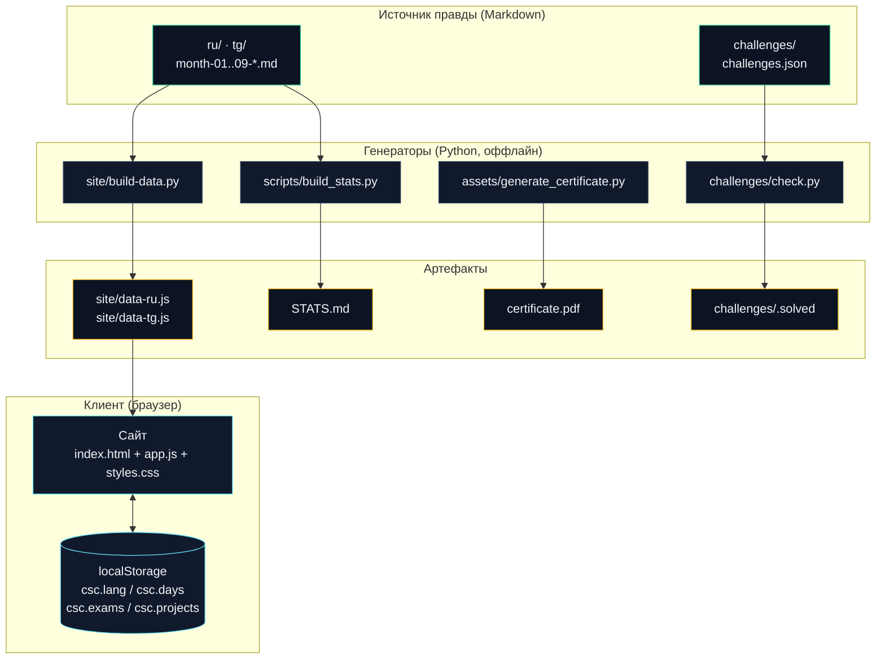

# 🏗️ Архитектура

Как устроен проект технически и как части взаимодействуют. Дополняет [docs/PROJECT.md](docs/PROJECT.md) (обзор) — здесь фокус на потоках данных и решениях.

---

## Главный принцип: один источник правды

Всё производное генерируется из **Markdown-файлов курса** (`ru/`, `tg/`, `challenges/`). Сайт, статистика и данные не дублируют контент — они его *читают*. Правишь курс → пересобираешь артефакты → всё синхронно.



Если диаграмма не рендерится — тот же поток текстом:

```
Markdown курса ──build-data.py──► data-<lang>.js ──► Сайт ◄──► localStorage
      │                                          (прогресс студента)
      ├──build_stats.py──► STATS.md
      │
challenges.json ──check.py──► .solved (решённые CTF)
      │
generate_certificate.py ──► certificate.pdf
```

---

## Компоненты и их границы

| Компонент | Технология | Вход | Выход | Состояние |
|---|---|---|---|---|
| Курс | Markdown | — | тексты | — |
| Парсер данных | Python (stdlib) | `month-*.md` | `data-<lang>.js` | — |
| Сайт | HTML/CSS/JS (без фреймворка) | `data-<lang>.js` (ленивая загрузка) | UI | `localStorage` |
| CTF-проверка | Python (hashlib) | флаг + `challenges.json` | вердикт | `.solved` |
| Статистика | Python (stdlib) | курс + `challenges.json` | `STATS.md` | — |
| Сертификат | Python (fpdf2) | имя, статистика | `certificate.pdf` | — |
| CI проектов | GitHub Actions (YAML) | репо студента | статус проверок | — |

**Ключевое свойство:** между компонентами нет скрытых связей. Каждый — самостоятельная утилита. Нет бэкенда, базы, сборки, аккаунтов. Всё запускается локально и хостится статикой.

---

## Поток данных сайта (детально)

```
ru/month-01-networks-linux.md
  ## Неделя 1 — …
    ### День 1 — Что такое сеть и модель OSI
      - 📺 Теория: …
      - 💻 Практика: …
      - ✍️ Задание: …
      - 🎯 Проверь себя: …
                │
                ▼  build-data.py: регэкспы по заголовкам и маркерам блоков
// data-ru.js (грузится только выбранный язык, ~360 КБ вместо 705 КБ на оба)
window.COURSE_DATA.ru = [ { num:1, title, goal, resources, videos, weeks:[…], days:[
    { num:1, title, week:1, theory, practice, task, check,
      links:[…], videos:[…], quiz:{q,o,a,e} }, … ] }, … ];
                │
                ▼  app.js
  рендер карточек месяцев, дней, поиск (по всем полям), i18n, прогресс
```

Из-за этого **формат дня менять нельзя**: парсер опирается на `### День N —`, `## Неделя N —` и маркеры `📺/📖 💻 ✍️ 🎯`. Сломаешь формат — сломаешь сайт. Правило зафиксировано в [TRANSLATION_GUIDE.md](TRANSLATION_GUIDE.md) и [RELEASE_CHECKLIST.md](RELEASE_CHECKLIST.md).

---

## Модель состояния (прогресс студента)

Прогресс живёт **только в браузере студента** — ни сервера, ни сбора данных.

| Ключ localStorage | Что хранит |
|---|---|
| `csc.lang` | выбранный язык (`ru`/`tg`) |
| `csc.days` | массив номеров пройденных дней (1–270) |
| `csc.exams` | индексы сданных экзаменов |
| `csc.projects` | индексы завершённых проектов |
| `csc.quiz` | дни, где сдан проверочный тест |

Ранги (Bronze/Silver/Gold/Diamond) вычисляются из этого состояния на лету. Нумерация дней стабильна между версиями (кроме MAJOR) — прогресс переживает обновления курса (см. [VERSIONING.md](VERSIONING.md)).

---

## Безопасность CTF (почему так)

Флаги **не хранятся** в репозитории — только их `SHA-256`. `check.py` хеширует введённый флаг и сравнивает.

```
студент: check.py w01 "CSC{...}"
              │
        sha256(ввод) == flag_sha256 из challenges.json ?
              │
        да → отметить в .solved      нет → «неверно»
```

Свойство: подсмотреть ответ в исходниках нельзя (хэш необратим), но проверить свой — можно мгновенно и офлайн. Никакого сервера проверки не нужно.

---

## Решения и обоснования

| Решение | Почему |
|---|---|
| Статический сайт без фреймворка | Работает где угодно, бесплатный хостинг (Pages), не устаревает, нулевая сборка |
| Данные генерируются из Markdown | Единый источник правды; сайт и тексты не разъезжаются |
| Прогресс в localStorage | Приватность, ноль инфраструктуры, ноль сбора данных |
| Флаги как SHA-256 | Оффлайн-проверка без раскрытия ответов |
| Python только stdlib (кроме сертификата) | Минимум зависимостей; запускается «из коробки» |
| Двуязычность как параллельные папки | Простая ментальная модель, легко добавить язык |
| Кириллица → UTF-8 в скриптах | Windows-консоль (cp1251) иначе падает |

---

## Требования к окружению

- **Python 3.8+** — для генераторов и CTF-проверки.
- **fpdf2** — только для генератора сертификата (`pip install fpdf2`).
- **Браузер + любой статический сервер** — для сайта.
- Node.js / npm / сборщики — **не нужны**.

Подробнее — [docs/PROJECT.md, раздел 16](docs/PROJECT.md#16-технические-детали-и-требования).
